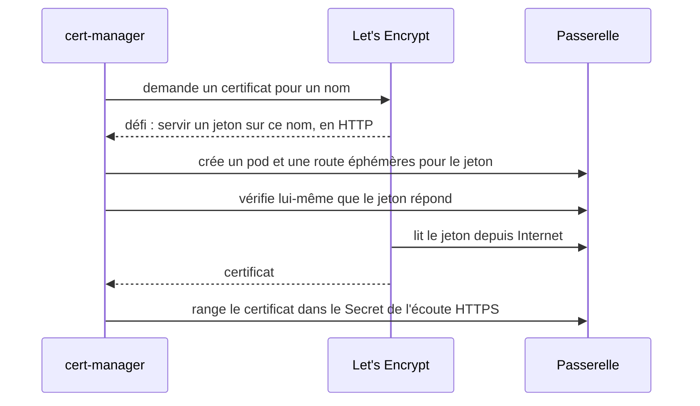

# cert-manager

Obtient et renouvelle les certificats de la passerelle auprès de Let's Encrypt ([ADR 0013](../../docs/adr/0013-certificats-par-cert-manager-et-lets-encrypt.md)).

| Objet | Rôle |
| --- | --- |
| ClusterIssuer `letsencrypt-staging` | Émetteur de test : certificats non reconnus, limites larges |
| ClusterIssuer `letsencrypt-production` | Émetteur de production : certificats reconnus par les navigateurs |
| NetworkPolicy, CiliumNetworkPolicy | Le contrôleur ne joint que Let's Encrypt et les noms de la zone ; le webhook ne reçoit que l'API de Kubernetes |

Le certificat lui-même n'est pas ici : il est déclaré avec l'écoute HTTPS qui le lit, dans le chart [`gateway`](../gateway).

## Comment un certificat est obtenu

Le pod et la route du défi vivent quelques secondes, dans l'espace de noms de la passerelle.

## Choix notables

- **Défi HTTP-01** : aucun secret extérieur dans le cluster. Le nom doit déjà désigner le load balancer.
- **Sans adresse de contact** : Let's Encrypt n'en demande pas.
- **Tout dans son espace de noms**, y compris l'élection du composant actif, que le chart place par défaut dans `kube-system`.
- **Retirer l'application ne supprime rien** : ses CRD emporteraient les certificats.

## Exploitation

Voir le runbook [suivre-les-certificats](../../docs/runbooks/suivre-les-certificats.md).
