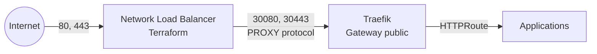

# Passerelle

Point d'entrée du trafic web dans le cluster ([ADR 0012](../../docs/adr/0012-exposer-par-un-network-load-balancer-et-gateway-api.md)) : Traefik, en contrôleur Gateway API.

| Objet | Rôle |
| --- | --- |
| GatewayClass `traefik` | Désigne Traefik comme contrôleur |
| Gateway `public` | Écoutes publiques, et espaces de noms autorisés à s'y attacher |
| Service `gateway-traefik` | Ports fixes des nœuds, que vise le load balancer |
| NetworkPolicy, CiliumNetworkPolicy | Traefik ne reçoit que le load balancer, et ne sort que vers l'API de Kubernetes et les applications exposées |

Les CRD de Gateway API ne sont pas dans ce chart : l'application `gateway-api` les lit dans le dépôt officiel ([`apps/values.yaml`](../apps/values.yaml)).

## Exposer une application

1. Ajouter son espace de noms à `routeNamespaces`, dans [`values.yaml`](values.yaml) : la passerelle accepte alors ses routes, et peut la joindre.
2. Dans le chart de l'application, créer une HTTPRoute attachée à la passerelle `public`, et une NetworkPolicy qui laisse entrer l'espace de noms `gateway`. Le chart [`rtgre`](../rtgre) sert de modèle.

## Choix notables

- **Gateway API seulement** : les fournisseurs Ingress et IngressRoute de Traefik sont désactivés, et ses propres CRD ne sont pas installées. Les routes restent portables vers un autre contrôleur.
- **Le port d'une écoute est celui du pod**, pas le port public : c'est une particularité de Traefik. L'écoute `web`, port 8000, reçoit le port 80 du load balancer.
- **PROXY protocol** : le load balancer transmet l'adresse du client en tête de connexion. Traefik ne l'accepte que du sous-réseau du load balancer (`loadBalancerCidr`).
- **`externalTrafficPolicy: Local`** : le nœud ne masque pas l'adresse du load balancer. Sans cela, Traefik ne reconnaîtrait pas la source autorisée.
- **Deux valeurs liées à Terraform** : `loadBalancerCidr` et les `nodePort`. Elles sont aussi dans `terraform/envs/prod/prod.auto.tfvars`, et doivent changer ensemble.
- **Aucune sortie vers Internet**, pas même en DNS : Traefik joint les applications par leur adresse.
- **Le port 443 répond déjà**, avec le certificat autosigné de Traefik et sans aucune route. L'écoute HTTPS et ses certificats arrivent avec cert-manager.

## Versions

Chaque version de Traefik prend en charge une version précise de Gateway API. Renovate propose leurs montées, mais elles attendent une approbation : elles se font ensemble, après lecture de la [page de Traefik](https://doc.traefik.io/traefik/reference/install-configuration/providers/kubernetes/kubernetes-gateway/).
