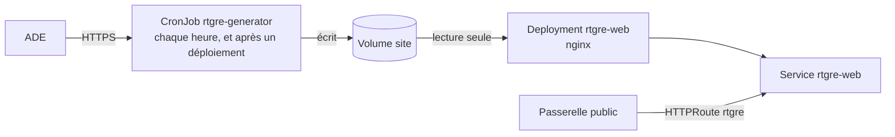

# rtgre

Le site [rtgre.fr](https://rtgre.fr), tel que le cluster le génère et le sert. Le code du site vit dans le dépôt [rtgre](https://github.com/kzsxwsjuldvcbsqt/rtgre), qui publie l'image de son générateur.

| Objet | Rôle |
| --- | --- |
| CronJob `rtgre-generator` | Génère le site chaque heure, une génération à la fois. Il remplace le site publié d'un seul coup : nginx ne sert jamais un site à moitié écrit. |
| Job `rtgre-generator-sync` | Génère le site à la fin de chaque synchronisation par Argo CD : un déploiement est publié aussitôt, sans attendre l'heure suivante. |
| Deployment `rtgre-web` | nginx sert le volume en lecture seule. Sur un volume vide, un conteneur d'initialisation génère d'abord le site. |
| PersistentVolumeClaim `site` | Volume local déclaré dans [`storage`](../storage) : le dernier site publié survit au redémarrage des pods. |
| CronJob `rtgre-log-retention` | Remplace le pod du serveur web chaque semaine : ses journaux disparaissent avec lui. |
| HTTPRoute `rtgre` | Attache le site à la [passerelle](../gateway) du cluster, pour les noms de `hostnames`. |
| HTTPRoute `rtgre-redirect` | Renvoie les noms de `redirectHostnames`, comme `www`, vers le nom principal. |
| NetworkPolicy, CiliumNetworkPolicy | Seule la passerelle entre dans l'espace de noms. Le générateur ne sort que vers ADE, en HTTPS. |

## Choix notables

- **Quand ADE ne répond pas**, le générateur s'arrête sans toucher au site publié, et l'heure suivante réessaie. C'est le comportement du déploiement sur GitHub Pages.
- **Un déploiement est publié aussitôt** : le Job `rtgre-generator-sync` est un crochet `PostSync` d'Argo CD, lancé une fois les nouveaux objets en place et sains. Argo CD ne synchronise que si un objet du chart change, ce qui est le cas d'une nouvelle image : sans changement, seule la génération horaire tourne. Le Job n'échoue pas quand ADE ne répond pas (`generator.unavailableExitCode`) : un déploiement ne dépend pas d'ADE. Toute autre erreur fait échouer la synchronisation, qu'Argo CD rejoue. Le générateur pose un verrou sur le volume : deux générations simultanées ne peuvent pas publier en même temps.
- **Sans privilège** : les deux images tournent sous un utilisateur ordinaire, système de fichiers en lecture seule, sans capacité, dans un espace de noms au niveau Pod Security `restricted`. L'image officielle de nginx est lancée sans son script d'entrée, sur le port 8080.
- **Partage du volume par le groupe** : le générateur (utilisateur 65532) écrit, nginx (utilisateur 101) lit, tous deux par le `fsGroup` 65532.
- **Sortie filtrée par nom** : une NetworkPolicy ne filtre que des adresses, et celles d'ADE peuvent changer. La politique de Cilium autorise le nom `generator.adeHost`, et son proxy DNS refuse tout autre nom. Les pods demandent ce nom tel quel (`ndots: 1`) : un refus sur un domaine de recherche du cluster arrêterait la résolution.
- **Journaux de visite sans adresse complète** ([ADR 0014](../../docs/adr/0014-journaux-de-visite-sans-adresse-complete.md)) : nginx ne garde que le réseau du visiteur, un /24 en IPv4 et un /48 en IPv6, et aucun journal ne dépasse quatorze jours.
- **L'adresse du visiteur n'est crue que de la passerelle** : nginx n'accepte l'en-tête `X-Forwarded-For` que d'un pod du cluster (`web.trustedProxies`), en plus de la règle réseau qui ne laisse entrer que la passerelle.
- **Redémarrage sans coupure** : le nouveau pod démarre avant l'arrêt de l'ancien, et nginx sert encore dix secondes après la demande d'arrêt, le temps que la passerelle se détourne de lui.
- **Comme GitHub Pages** : mêmes codes de réponse, mêmes types de contenu, même durée de cache, `/page` sert `page.html`. nginx ajoute trois en-têtes de sécurité.
- **En HTTPS, avec HSTS**, sous `rtgre.fr` depuis la bascule du 21 novembre 2026. `www.rtgre.fr` renvoie vers lui, et `test.rtgre.fr` reste disponible pour valider une modification. GitHub Pages reste déployé en secours ([runbook](../../docs/runbooks/basculer-rtgre-fr.md)).

## Mise à jour de l'image

L'image du générateur est référencée par son empreinte. Quand le dépôt rtgre en publie une nouvelle, son workflow `Image` déclenche le workflow `Promote` de ce dépôt, qui propose la nouvelle empreinte et la fusionne une fois les contrôles passés ([ADR 0028](../../docs/adr/0028-mettre-en-ligne-l-image-du-site-par-un-workflow-declenche.md)). Argo CD déploie, puis le Job `rtgre-generator-sync` publie le site. Suivre une mise en ligne, ou la faire à la main : [runbook](../../docs/runbooks/suivre-une-mise-en-ligne-du-site.md).

Le job « Images (cosign) » n'accepte qu'une image signée par le workflow `image.yml` de rtgre sur sa branche principale ([`signed-images.txt`](../kyverno/files/signed-images.txt)). Le cluster vérifie la même signature à chaque création de pod, et n'admet dans cet espace de noms que les dépôts déclarés ([`kyverno`](../kyverno)).

## Exploitation

Voir le runbook [suivre-la-generation-du-site](../../docs/runbooks/suivre-la-generation-du-site.md).
